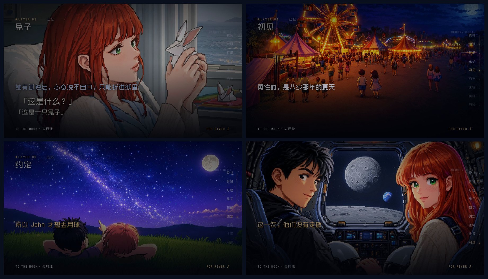
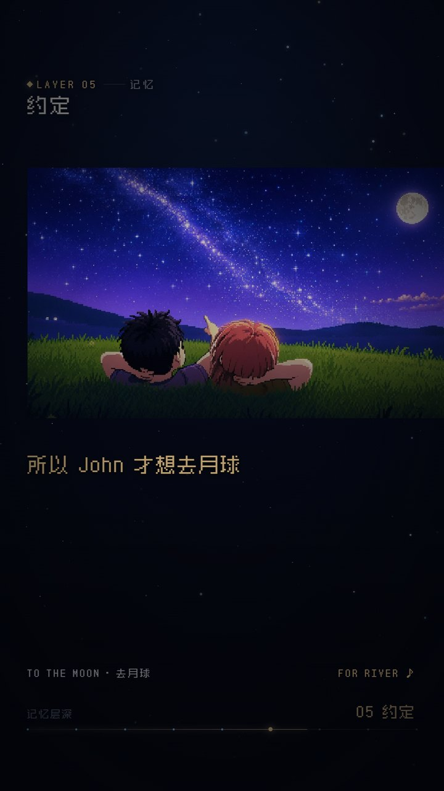

# 去月球 · To The Moon

用 Remotion 做的《去月球》同人短片：5 分 13 秒，像素风，一镜到底的「记忆下沉」结构——
从月球与灯塔开始，按 `LAYER 00 → 07` 一层层往下，最后回到月球。片长与配乐对齐。



同一份场景代码输出两个版本：

| Composition | 尺寸 | 用途 |
| --- | --- | --- |
| `ToTheMoon` | 1920×1080 | 横版 |
| `ToTheMoonVertical` | 1080×1920 | 手机竖版 |



## 快速开始

```bash
npm install
npm run dev            # Remotion Studio, http://localhost:3000
npm run render         # 横版 → out/to-the-moon.mp4
npm run render:vertical
```

渲染前需自备音轨 `public/for-river.mp3`（原因见 [素材与版权](docs/素材与版权.md)）。
其它脚本：

```bash
npm run typecheck
npm run check:script   # public/script.md 与 src/scenes 的旁白是否逐行同步
```

## 结构

```
src/
  timeline.ts     时间轴与层定义（唯一真源，改节奏只动这里）
  layout.ts       横版/竖版两套排版，字号对齐 12px 像素网格
  theme.ts        配色 + snap()（Zpix 是 12px 点阵字体）
  Film.tsx        拼装场景、全局星空/刻度、音轨
  components/     Shot（镜头运动）、Text（逐字打出）、DepthGauge、Motifs（兔子/月球）
  scenes/         S1..S10，一场一个文件
  tools/          出图与校对脚本（comfy.py、gen_*、to_web.py、jobs/ 提示词）
public/           文稿、人物设定、字体、镜头图（img/）、出图产物（gen/）
docs/             剧情分镜、出图流水线、排查记录、素材版权
```

改文案：进 `src/scenes/Sx*.tsx` 找 `<Line text="…" at={帧}>`。
改节奏：`src/timeline.ts` 的 `SEGMENTS`（单位秒），场景内部节拍按本地帧数写。

## 文档

| 文档 | 内容 |
| --- | --- |
| [剧情与分镜](docs/剧情与分镜.md) | 五幕骨架、八层分镜表与每层的交接句 |
| [出图流水线](docs/出图流水线.md) | MOSS-Image 出图、角色参考图强度、提示词真源 |
| [排查记录](docs/排查记录.md) | 播放卡顿、近黑镜头、底部黑边的实测与结论 |
| [素材与版权](docs/素材与版权.md) | 截图 / 音乐 / 字体来源，哪些不进仓库 |

## 版权

非商业同人致敬作品。《去月球》的角色、剧情、音乐版权归 **Freebird Games / Kan Gao** 所有。
游戏截图与音轨不随仓库分发，细节见 [素材与版权](docs/素材与版权.md)。
